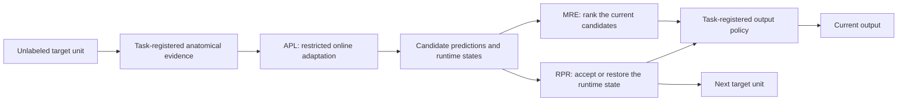

# APSA

**Task-registered continual test-time adaptation for medical image
segmentation**

This repository accompanies the manuscript *State-Aware Continual Test-Time
Adaptation via Anatomical Prior Guidance for Medical Image Segmentation*.
APSA uses a shared **evidence–adapt–select–retain** procedure while registering
the anatomical evidence, mutable runtime variables, candidate predictions, and
state-retention policy separately for each task.

> **Release status.** This is a compact, source-available inspection release
> containing the three APSA task runners, frozen launcher arguments, and
> cardiac controller tests.
> It is an experiment overlay, not a standalone CTTA library or a sealed
> artifact that reproduces every manuscript table from a clean checkout. Data,
> source weights, case-level results, and final statistical-analysis scripts
> are not redistributed. The prostate runner additionally requires an
> APSA-compatible PASS worktree described below.

## Method at a glance

For each unlabeled target unit, APSA constructs task-conditioned anatomical
evidence, updates a restricted runtime state, scores a bank of candidate
predictions, and independently decides which state is inherited by the next
unit.



| Component | Role |
|---|---|
| **APL** | Adds task-related spatial or structural evidence to the unsupervised online adaptation objective. |
| **MRE** | Ranks available predictions using the cues enabled for that task, such as prior alignment, entropy, area, center, or topology. |
| **RPR** | Controls whether a candidate runtime state is inherited by subsequent samples. Its restoration scope and fallback behavior are task-specific. |

MRE and RPR answer different questions: selecting a prediction for the current
sample does not determine which runtime state should be carried forward. A
task's output policy may keep the MRE-selected prediction or return a registered
pre-update fallback after an RPR rejection. RPR is therefore a state-retention
controller; it is not expected to improve every stream and is not a clinical
safety mechanism.

## Manuscript task registrations and protocols

The manuscript's three task registrations share the APSA procedure, but they
do not use an identical loss, loader, optimizer state, or rollback rule.

| Task | Source and target protocol | Online unit | Registered evidence and state | Primary metrics |
|---|---|---|---|---|
| Cardiac M&Ms | Domain A (95 cases) source; persistent B (125) → C (75) → D (50) target stream without a domain reset | Non-shuffled mini-batch of up to 10 preprocessed 2-D slices; the public loader does not assert patient boundaries | Source/anatomy-guided candidate bank; restricted BN adaptation; pre-update state restoration | DSC, surface distance |
| Multi-site prostate MRI | RUNMC (30 cases) source; BMC (30), I2CVB (19), UCL (13), BIDMC (12), and HK (12) are five independently initialized target streams | One 3-D case | Fixed BioMedCLIP localization map; prompt/data/ViDA/BN adaptation; case-level selection and rollback | DSC, HD95 |
| Fundus OD/OC | Each of five domains serves as source once; the other four form that job's target stream | One fundus image | Prediction-derived adaptive OD support and cup-inside-disc constraint; Fourier-prompt update with AdaBN; prompt-only rollback | OD DSC, OC DSC, mean DSC |

The packaged fundus launcher is **not** the manuscript Table IV recipe. Besides
evaluating the `train_test` manifests for three rounds, it leaves the
adaptive-OD flags disabled and instead enables nonzero central-prior and
cup-prior loss weights. The manuscript configuration uses one round,
prediction-derived adaptive OD support, the cup-inside-disc constraint, and no
prior-supervised loss (`lambda_pi = 0`). The packaged fundus command is
therefore an unsupported post-manuscript snapshot variant and must not be used
to attribute the 74.48 value below.

The task settings were developed retrospectively on these reported benchmarks,
and no independent target-domain development/test partition was reserved for
configuration selection. The results characterize fixed benchmark protocols;
they are not confirmatory validation on unseen clinical domains.

## Manuscript-reported results — not reproduced by this snapshot

The values below are copied from the manuscript summary tables for orientation.
They have not been recomputed from this compact repository, and no statistical
significance claim is attached here because the paired case-level artifacts and
final testing script are not included. The cardiac headline uses the ordinary
per-unit RPR policy rather than the later checkpointed `plus` extension; the
fundus headline uses a single target-stream round rather than the packaged
three-round extension.

| Task | Comparator | APSA | Descriptive delta |
|---|---:|---:|---:|
| Cardiac M&Ms, Tables I–II | Locally reproduced A3-TTA: 79.23±23.30 DSC / 3.10±2.69 reported ASSD | **80.37±21.04 DSC / 2.85±2.41 reported ASSD** | +1.14 DSC / −0.25 reported ASSD |
| Prostate MRI, Table III | Locally evaluated PASS: 78.04±5.18 DSC / 15.47±8.98 reported HD95 | **80.37±4.13 DSC / 8.23±3.10 reported HD95** | +2.33 DSC / −7.24 reported HD95 |
| Fundus OD/OC, Table IV | Published VPTTA reference: 71.93 mean DSC | **74.48 mean DSC** | +2.55 DSC |

DSC is reported in percent. The manuscript labels its distance columns in
millimetres, but the audited cardiac evaluator records preprocessed-pixel units
and the audited prostate evaluator calls MedPy without voxel spacing after
array preprocessing. The physical-unit provenance is therefore unresolved in
this snapshot. This README treats those distance entries as reported evaluator
values, not as independently verified millimetre measurements; see
[Evaluation details](#evaluation-details) before comparing files.
Results are comparable only within the corresponding task-specific protocol.
The cardiac and prostate comparators were evaluated locally, whereas the
fundus comparator is a descriptive published reference.

## What is included

| Item | Status in this snapshot |
|---|---|
| APSA task runners and frozen launch arguments | Included |
| Cardiac Source-A calibration summaries and RPR policy | Included |
| Cardiac RPR checkpoint-controller unit tests | Included |
| BioMedCLIP prior generator | Included as an unverified legacy utility; not a current reproduction recipe |
| Raw medical data, labels, and split files | Not redistributed |
| Source-model and adapted checkpoints | Not redistributed |
| Complete A3-TTA, PASS, and VPTTA worktrees | External dependencies |
| APSA-compatible PASS integration changes | Required but not yet redistributed |
| Exact fundus Table IV launcher | Not included; the packaged launcher is a different post-manuscript variant |
| Prediction masks, full logs, case-level metric tables, and final statistics | Not included |
| One-command reproduction of every manuscript table and p-value | Not claimed by this snapshot |

File-level hashes and the explicit packaging exclusions are recorded in
[`docs/RELEASE_SCOPE.md`](docs/RELEASE_SCOPE.md).

The code layout is:

```text
apsa/
  cardiac/apsa_mms.py
  prostate/apsa_prostate.py
  prostate/generate_biomedclip_priors.py
  prostate/convert_clip_priors_npy_to_npz.py
  fundus/apsa_optic.py
configs/
  cardiac_base.yaml
  cardiac_source_calibrator.json
  cardiac_rpr_policy.json
  run_cardiac.sh
  run_prostate.sh
  run_fundus.sh
docs/
  DATA_AND_WEIGHTS.md
  RELEASE_SCOPE.md
tests/
  test_cardiac_rpr_checkpoint_controller.py
THIRD_PARTY_LICENSES/
  VPTTA_LICENSE
```

## Data provenance

Datasets must be obtained from their original providers. A3-TTA, PASS, and
VPTTA are **software dependencies**, not dataset sources, and no medical data
is redistributed here.

| Task | Original data source | APSA domains |
|---|---|---|
| Cardiac MRI | [M&Ms Challenge](https://www.ub.edu/mnms/) ([access request](https://www.ub.edu/mnms/download.php)) | Source A; targets B → C → D |
| Prostate MRI | [NCI-ISBI 2013](https://www.cancerimagingarchive.net/analysis-result/isbi-mr-prostate-2013/) (RUNMC, BMC), [I2CVB/HCRUDB](https://i2cvb.github.io/), and [PROMISE12](https://promise12.grand-challenge.org/Details/) (UCL, BIDMC, HK) | RUNMC source; five target sites |
| Fundus OD/OC | RIM-ONE-r3, [REFUGE](https://refuge.grand-challenge.org/Details/), ORIGA, and [Drishti-GS1](https://cvit.iiit.ac.in/projects/mip/drishti-gs/mip-dataset2/Home.php) | Five registered-domain jobs, including two disjoint REFUGE cohorts |

`HK` is Haukeland University Hospital, Norway. `REFUGE_Valid` is the loader
alias for REFUGE-Eval800 rather than a separate dataset. Case counts, official
access pages, citations, aliases, and expected layouts are documented in
[`docs/DATA_AND_WEIGHTS.md`](docs/DATA_AND_WEIGHTS.md).

## Upstream compatibility

The following revisions were used as the bases for the current public-code
audit. They document an inspectable compatibility point; they are not being
represented as independently recovered experiment-time commits.

| Task | Upstream software | Audited revision | Status |
|---|---|---|---|
| Cardiac | [A3-TTA](https://github.com/HiLab-git/A3-TTA) | [`9867570`](https://github.com/HiLab-git/A3-TTA/commit/98675706ac120f08fa504632e94b3cf375b750d6) | Import/structure-audited base; end-to-end result reproduction not verified |
| Prostate | [PASS](https://github.com/EndoluminalSurgicalVision-IMR/PASS) | [`0b7f66d`](https://github.com/EndoluminalSurgicalVision-IMR/PASS/commit/0b7f66d494d7353ee1b04701f943412ac5937ce7) | Provenance base only; a plain checkout is **not** sufficient for the frozen APSA configuration |
| Fundus | [VPTTA](https://github.com/Chen-Ziyang/VPTTA) | [`7e0a377`](https://github.com/Chen-Ziyang/VPTTA/commit/7e0a3776100d1350cd2bd0c9c3431522c5940027) | Import/structure-audited base; end-to-end result reproduction not verified |
| Prostate prior | [BioMedCLIP](https://huggingface.co/microsoft/BiomedCLIP-PubMedBERT_256-vit_base_patch16_224) | `9f341de24bfb00180f1b847274256e9b65a3a32e` | Intended checkpoint identifier; the packaged legacy generator is not load-verified |

The frozen prostate configuration relies on APSA-compatible changes to PASS's
ViDA/HKA model construction, named optimizer groups, EMA/reset handling, and
path configuration. Until a license-audited patch or fixed fork is published,
[`configs/run_prostate.sh`](configs/run_prostate.sh) should be treated as a
runner snapshot for a prepared compatible worktree, not as a drop-in command
for vanilla PASS. Running it against unmodified PASS may silently omit intended
trainable components and will not reproduce the manuscript configuration.

## Environment

The original experiments used Python 3.7.9, PyTorch 1.13.1, and TorchVision
0.14.1. Install the CUDA-compatible PyTorch build separately, then install the
shared additional packages:

```bash
python -m venv .venv
source .venv/bin/activate
python -m pip install --upgrade pip
# Install torch==1.13.1 and torchvision==0.14.1 for the local CUDA runtime.
python -m pip install -r requirements.txt
```

`requirements.txt` is a shared dependency list, not a complete environment
lock. Install each upstream project's task-specific requirements as well.
Separate environments are recommended because the three research codebases
were not designed as one Python package. The manuscript reports NVIDIA A40
GPUs; this snapshot does not provide a runtime or memory benchmark.

## Data and weight preparation

Use absolute paths in all launcher variables. Each launcher changes its working
directory to the upstream codebase, so relative data, prior, checkpoint, or
output paths can resolve differently after launch.

- **Cardiac:** prepare M&Ms using the A3-TTA 2-D layout, including
  `<A3_ROOT>/data/mms2d/{A,B,C,D}/all.csv`, and pass the Source-A checkpoint
  explicitly through `CHECKPOINT`.
- **Prostate:** the data root and Source-RUNMC checkpoint are resolved by
  `scripts/tta_configs.py` in the prepared APSA-compatible PASS worktree. Check
  those paths before running; the launcher does not override them.
- **Fundus:** provide the five registered manifest sets under `DATASET_ROOT`.
  Each manifest uses `image,mask` paths relative to that root. Source weights
  must be stored as `<MODEL_ROOT>/<source>/last-Res_Unet.pth`.

No checkpoint is licensed or redistributed by this repository.

### Prostate prior artifact status

The online prostate registration consumes a fixed localization map and does not
run a text encoder. The packaged legacy utility hard-codes the single prompt
`Prostate gland.`, but the prompt set and preprocessing provenance of the exact
maps used for the reported experiment are not established by this snapshot;
those maps are not redistributed.

`apsa/prostate/generate_biomedclip_priors.py` is retained only as a legacy
inspection utility. A local release audit found substantial missing and unexpected
state-dictionary keys when it was loaded with the BioMedCLIP revision listed
above, including unloaded image-projection and text-encoder parameters. Because
the script does not currently fail on that mismatch, its output must **not** be
used as a reproduction of the reported priors. A corrected loader, a
load-coverage test, preprocessing metadata, and checksums for reference maps are
still required.

If a verified experiment-generated `*_clip.npy` artifact is already available,
the included format-only converter produces the portable `.npz` file read by
the runner:

```bash
python apsa/prostate/convert_clip_priors_npy_to_npz.py \
  --root /abs/path/to/MRI_prostate/clip_priors
```

The converter changes serialization only; it does not validate how a map was
created. Maps remain fixed during target adaptation. Verify that every target
case has a readable prior: a missing case prior currently produces a warning
and continues with a non-reference fallback rather than terminating the run.

## Running the packaged launchers

### Cardiac M&Ms

```bash
BASE_ROOT=/abs/path/to/A3-TTA \
CHECKPOINT=/abs/path/to/source-A.pth \
OUTPUT_ROOT=/abs/path/to/outputs/cardiac \
PYTHON=/abs/path/to/python \
SURFACE_ASSD_PROTOCOL=sictta_capped \
bash configs/run_cardiac.sh --run 0 BCD current
```

The positional arguments are `GPU`, three-character domain `ORDER`, and
`POLICY`. `current` uses the ordinary per-unit pre-update RPR behavior described
in the manuscript. `plus` is a later checkpointed-retention extension using a
Source-A-selected interval of 3; it is not the configuration associated with
the manuscript's 80.37/2.85 headline. The reference order is `BCD`, and state
is preserved across those domains.

### Multi-site prostate MRI runner snapshot

This is a **non-executable archival invocation** documenting the private
prepared worktree. The public artifacts are insufficient to run or reproduce
Table III, and a vanilla PASS checkout is not compatible. A license-audited
integration patch or fixed compatible fork must be published before this
becomes a public reproduction command.

```bash
BASE_ROOT=/abs/path/to/APSA-compatible-PASS \
CLIP_PRIOR_ROOT=/abs/path/to/MRI_prostate/clip_priors \
OUTPUT_ROOT=/abs/path/to/outputs/prostate \
GPU=0 \
DOMAINS="BIDMC BMC HK I2CVB UCL" \
EXP_NAME=apsa_frozen_reference \
PYTHON=/abs/path/to/python \
bash configs/run_prostate.sh
```

Each domain starts in a new process from the same source initialization; state
is continual only within that domain. The five jobs run sequentially on the
selected GPU. This command requires the compatible PASS integration described
above.

### Fundus OD/OC

```bash
BASE_ROOT=/abs/path/to/VPTTA/OPTIC \
DATASET_ROOT=/abs/path/to/Fundus \
MODEL_ROOT=/abs/path/to/source/checkpoints \
OUTPUT_ROOT=/abs/path/to/outputs/fundus \
GPU=0 \
PYTHON=/abs/path/to/python \
bash configs/run_fundus.sh
```

The packaged job iterates over all five source domains and requires CUDA. It is
an unsupported post-manuscript snapshot variant: the five source jobs run
sequentially, each uses three rounds, the adaptive-OD flags remain disabled,
and the launcher uses nonzero central/cup prior-loss weights. BioMedCLIP is
disabled. The manuscript's one-round adaptive-support Table IV
configuration is not exposed by this launcher, and 74.48 is not an output claim
for the command above.

Legacy internal labels such as `--use-apssa` and the fundus `RATTA/` log folder
are retained for checkpoint and path compatibility; in this repository they
refer to the packaged APSA runners, not additional methods.

## Outputs and restart behavior

| Runner | Default output |
|---|---|
| Cardiac | `<OUTPUT_ROOT>/<ORDER>_<POLICY>/config.json`, `summary_table.csv`, and per-domain Dice/surface-distance, case-summary, candidate-trace, and branch-audit CSV files |
| Prostate | One `<domain>.log` plus a PASS-style run directory containing timestamped metric CSV files and prediction archives |
| Fundus | `<OUTPUT_ROOT>/<source>/RATTA/<timestamp>.log`; per-case CSV/NPZ files are disabled by the frozen launcher |

Metric scales differ across the inherited evaluators. Cardiac
`dice_all.csv`/`summary_table.csv` and prostate `*_results.csv` store Dice as a
0–1 fraction, whereas the fundus log reports Disc/Cup/Mean Dice in percent. The
headline table above uses percent.

Cardiac and fundus launchers refuse to overwrite an existing run directory.
The prostate launcher skips a domain when it finds an existing result CSV.
After a failed run, inspect or move the partial directory before retrying. The
launchers preflight only their top-level paths; nested manifests, per-domain
weights, and individual prior files are only encountered by the underlying
runner at runtime. In particular, missing prostate priors warn and fall back
rather than failing the job.

The prostate launcher enables prediction archives for evaluation. Those files
also contain the target array loaded for post-hoc metric computation, so they
must be protected under the original dataset terms and must not be committed.

## Evaluation details

- Target labels are not consumed by online adaptation, candidate selection, or
  state retention. The current research loaders still require labels/masks in
  the same process for post-hoc evaluation.
- The cardiac calibration JSON files were developed from Source-A perturbation
  experiments. Source-A reference labels/metrics were used offline to choose
  the frozen policy interval; no target-domain labels were used for that
  choice or during target adaptation.
- With `SURFACE_ASSD_PROTOCOL=sictta_capped`, the public cardiac runner computes
  per-slice 2-D distances in preprocessed pixels, applies a 10-pixel cap, uses
  10 when exactly one mask is empty, and 0 when both masks are empty. Its
  `config.json` records `surface_metric_unit: pixel`. Do not relabel this output
  as millimetres without an audited, spacing-aware recomputation.
- The prostate `get_dice_assd_hd` path calls MedPy ASSD/HD95 without a
  `voxelspacing` argument on preprocessed arrays. Those outputs are array-grid
  evaluator units, not verified physical millimetres. A spacing-aware metric
  pipeline must be audited before using an `mm` label.
- Published reference rows and locally evaluated comparators have different
  evidentiary status. Do not perform paired significance tests against a row
  for which matched case predictions are unavailable.
- This snapshot intentionally makes no public p-value or `†` claim. Any future
  significance release should include the paired case identifiers, raw and
  adjusted p-values, correction families, and the exact statistics script.

## Tests

With APSA and the audited A3-TTA base on `PYTHONPATH`, run:

```bash
PYTHONPATH="/abs/path/to/APSA:/abs/path/to/A3-TTA" \
python -m unittest discover -s tests -v
```

These tests cover the cardiac RPR checkpoint-controller contracts only. They
are not end-to-end tests of the three medical-image experiments.

## Citation, licensing, and support

A final bibliographic entry and archival release tag will be added when the
manuscript record is public. Until then, cite the manuscript title and this
repository commit when reporting results derived from the code.

The runners integrate with external research repositories and checkpoints,
each governed by its own terms. This compact snapshot does not currently
assert a project-wide license for third-party-derived components. Review
[`THIRD_PARTY_NOTICES.md`](THIRD_PARTY_NOTICES.md) before reuse or
redistribution. Until an explicit project license and all required upstream
notices are supplied, publication of the source does not grant a general right
to copy, modify, or redistribute it. Dataset licenses apply independently.

For reproducibility questions or suspected documentation errors, open a
[GitHub issue](https://github.com/lixiangcog/APSA/issues) and include the APSA
commit, task, upstream revision, launcher command, and generated `config.json`
or log where available. Do not attach medical images, labels, patient
identifiers, or restricted checkpoints.
