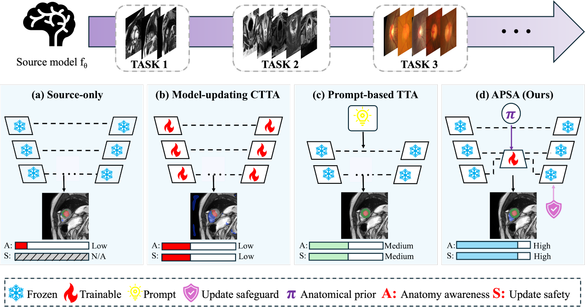

# APSA

Code accompanying the manuscript **State-Aware Continual Test-Time Adaptation via
Anatomical Prior Guidance for Medical Image Segmentation**.

Anatomical Prior-guided Selection and Adaptation (APSA) is a state-aware
continual test-time adaptation framework for medical image segmentation. It
turns task-specific anatomical knowledge into spatial and structural evidence,
uses that evidence to guide online adaptation, selects a prediction for the
current input, and separately decides which model state is passed to the next
input.

The same evidence–adapt–select–retain workflow is used for cardiac MRI,
prostate MRI, and fundus optic disc/cup segmentation. The anatomical evidence,
adapted variables, candidate predictions, and rollback scope are configured for
each task.



*APSA introduces anatomical evidence into both adaptation and prediction
selection, with a separate state-retention decision. The A and S bars in the
figure are qualitative illustrations rather than measured scores or clinical
safety guarantees.*

## Method

APSA has three main components:

- **Anatomical-prior-guided learning (APL)** adds task-relevant spatial or
  structural evidence to the online adaptation objective.
- **Multi-cue reliability estimation (MRE)** scores a fixed set of candidate
  predictions using the cues available for the task, including uncertainty,
  prior alignment, region size, location, and topology.
- **Risk-aware parameter reversion (RPR)** decides whether the candidate
  runtime state is retained or the task's predefined restorable variables are
  rolled back before the next input is processed.

In short, APL guides the update, MRE chooses the current prediction, and RPR
controls the state carried through the stream. Output selection and state
retention are deliberately kept separate.

## Experimental protocols

| Task | Source domain | Target protocol | Online unit |
|---|---|---|---|
| Cardiac MRI | M&Ms Domain A | One persistent B → C → D stream | Up to ten consecutive preprocessed 2-D slices |
| Prostate MRI | RUNMC | BMC, I2CVB, UCL, BIDMC, and HK; each target site starts from the same source state | One 3-D case |
| Fundus OD/OC | Each of the five registered domains or cohorts serves as source once | The other four form a persistent target stream | One image |

Cardiac and fundus adaptation continues across target-domain boundaries.
Prostate adaptation is continual within a site and is reinitialized for the
next site.

## Main results

The following mean DSC values are reported in the manuscript.

| Task | Source only | Reported comparator | APSA | Gain over source |
|---|---:|---:|---:|---:|
| Cardiac M&Ms | 69.72 | 79.23 (locally reproduced A3-TTA) | **80.37** | **+10.65** |
| Multi-site prostate MRI | 72.36 | 78.04 (locally evaluated PASS) | **80.37** | **+8.01** |
| Fundus OD/OC | 65.86 | 71.93 (published VPTTA result) | **74.48** | **+8.62** |

All values are percentages. The cardiac and prostate comparator values come
from local evaluation; the fundus VPTTA value is a descriptive published
reference. Full per-domain results, distance metrics, ablations, and statistical
analyses are given in the paper. Case-level predictions and the final statistics
script are not included in this release.

## Installation

Clone the repository and create an environment:

```bash
git clone https://github.com/lixiangcog/APSA.git
cd APSA

conda create -n apsa python=3.7.9 -y
conda activate apsa
```

The experiments used PyTorch 1.13.1 and TorchVision 0.14.1. Install the build
that matches your CUDA runtime, then install the shared dependencies:

```bash
python -m pip install -r requirements.txt
```

The three runners build on separate research codebases, so task-specific
environments may be easier to maintain:

- cardiac MRI: [A3-TTA](https://github.com/HiLab-git/A3-TTA)
- prostate MRI: [PASS](https://github.com/EndoluminalSurgicalVision-IMR/PASS)
- fundus OD/OC: [VPTTA](https://github.com/Chen-Ziyang/VPTTA)

## Data and source models

Datasets and pretrained source models are not distributed in this repository.
Obtain the data from the original providers and follow their access terms.

| Task | Original datasets | APSA setting |
|---|---|---|
| Cardiac MRI | [M&Ms Challenge](https://www.ub.edu/mnms/) | Domain A is the source; B, C, and D are targets |
| Prostate MRI | [NCI-ISBI 2013](https://www.cancerimagingarchive.net/analysis-result/isbi-mr-prostate-2013/), [I2CVB](https://i2cvb.github.io/), and [PROMISE12](https://promise12.grand-challenge.org/Details/) | RUNMC is the source; BMC, I2CVB, UCL, BIDMC, and HK are targets |
| Fundus OD/OC | [RIM-ONE-r3](https://medimrg.webs.ull.es/), [REFUGE](https://refuge.grand-challenge.org/Details/), [ORIGA](https://doi.org/10.1109/IEMBS.2010.5626137), and [Drishti-GS1](https://cvit.iiit.ac.in/projects/mip/drishti-gs/mip-dataset2/Home.php) | Five source-domain jobs; `REFUGE_Valid` denotes the REFUGE-Eval800 cohort |

Dataset citations, case counts, aliases, expected directory layouts, and source
checkpoint locations are listed in
[`docs/DATA_AND_WEIGHTS.md`](docs/DATA_AND_WEIGHTS.md). A3-TTA, PASS, and VPTTA
are upstream code dependencies; they are not the sources of the medical data.

## Run

All commands below are run from the APSA repository root. Use absolute paths
because each launcher changes into its upstream project directory.

### Cardiac M&Ms

```bash
BASE_ROOT=/abs/path/to/A3-TTA \
CHECKPOINT=/abs/path/to/source-A.pth \
OUTPUT_ROOT=/abs/path/to/outputs/cardiac \
PYTHON=/abs/path/to/python \
bash configs/run_cardiac.sh --run 0 BCD current
```

`BCD` is the reference stream order. The `current` policy is the per-unit RPR
setting used for the paper result; `plus` is a later checkpointed extension.

### Multi-site prostate MRI

The prostate runner expects the APSA-compatible PASS workspace used in the
experiments. The required PASS integration patch is not included in the current
release, so an unmodified PASS checkout is not sufficient for this command.

```bash
BASE_ROOT=/abs/path/to/APSA-compatible-PASS \
CLIP_PRIOR_ROOT=/abs/path/to/MRI_prostate/clip_priors \
OUTPUT_ROOT=/abs/path/to/outputs/prostate \
GPU=0 \
PYTHON=/abs/path/to/python \
bash configs/run_prostate.sh
```

### Fundus OD/OC

```bash
BASE_ROOT=/abs/path/to/VPTTA/OPTIC \
DATASET_ROOT=/abs/path/to/Fundus \
MODEL_ROOT=/abs/path/to/source/checkpoints \
OUTPUT_ROOT=/abs/path/to/outputs/fundus \
GPU=0 \
PYTHON=/abs/path/to/python \
bash configs/run_fundus.sh
```

Source checkpoints must be stored as
`<MODEL_ROOT>/<source>/last-Res_Unet.pth`. This launcher runs all five
source-domain jobs. It records a later three-round development configuration
and is not the one-round configuration used for the paper's Table IV result.

## Reproduction notes

This release contains the three APSA runners, launcher arguments, cardiac RPR
controller tests, and documentation. It does not contain medical data, source
weights, experiment-generated prostate prior maps, prediction files, or logs.

The prostate localization maps are fixed inputs during adaptation. The bundled
BioMedCLIP generator is retained as a legacy utility and has not been verified
as the recipe that produced the maps used in the paper. The public distance
evaluators operate on the preprocessed image grid; spacing-aware values in
millimetres should be recomputed before making a physical-unit claim.

See [`docs/RELEASE_SCOPE.md`](docs/RELEASE_SCOPE.md) for upstream revisions,
packaging boundaries, and known reproduction differences. Third-party sources
and notices are recorded in
[`THIRD_PARTY_NOTICES.md`](THIRD_PARTY_NOTICES.md).

## Tests

The included tests cover the cardiac RPR checkpoint controller:

```bash
PYTHONPATH="$(pwd):/abs/path/to/A3-TTA" \
python -m unittest discover -s tests -v
```

## Citation

```bibtex
@misc{hui2026apsa,
  title  = {State-Aware Continual Test-Time Adaptation via Anatomical Prior Guidance for Medical Image Segmentation},
  author = {Hui, De and Li, Xiang and Zhang, Dan and He, Xiangjian and Han, Chengzhi and Mi, Shengli and Li, Zhenjiang and Li, Mei and Wang, Meili},
  year   = {2026},
  note   = {Manuscript under review}
}
```

## Acknowledgements

This repository builds on
[A3-TTA](https://github.com/HiLab-git/A3-TTA),
[PASS](https://github.com/EndoluminalSurgicalVision-IMR/PASS),
[VPTTA](https://github.com/Chen-Ziyang/VPTTA), and
[BioMedCLIP](https://huggingface.co/microsoft/BiomedCLIP-PubMedBERT_256-vit_base_patch16_224).

## License

The repository includes components adapted to upstream research code and does
not currently define a single project-wide license. Review
[`THIRD_PARTY_NOTICES.md`](THIRD_PARTY_NOTICES.md) before reuse or
redistribution. Dataset and checkpoint terms apply separately.
